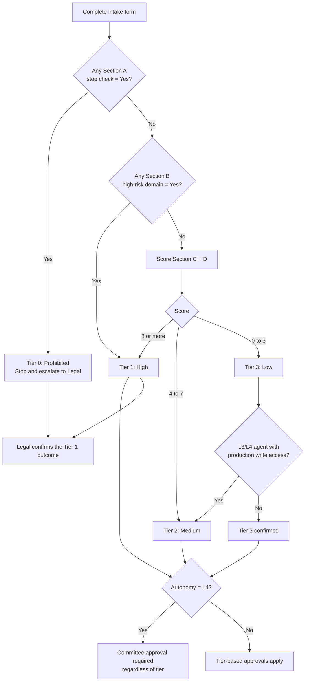

# Risk Tier Decision Flow and Definitions

**Reading the diagram**
- **L4 is never Tier 3.** L4 scores 4 points on its own, which already lands in Tier 2 (score 4-7) even with no Section C factors and no production write access. The agent-floor branch therefore matters mainly for L3 (2 points). L4 always needs Committee approval, whatever its tier.
- **Legal confirms every Tier 0 and every Tier 1 outcome**, including a Tier 1 reached by score alone (8 or more) with no Section B domain. Legal also confirms any borderline classification.

## Tier definitions

| Tier | Name | Typical examples | Governance intensity |
|---|---|---|---|
| **0** | Prohibited / Stop | Social scoring, emotion inference at work | Do not proceed; Legal review |
| **1** | High | Credit scoring, CV screening, clinical triage, autonomous agents changing financial records | Full gate path, impact assessment, Committee approval, continuous monitoring |
| **2** | Medium | Customer-facing chatbot with human fallback, internal agent with scoped write access | Gate path with Risk/Legal/InfoSec review, lightweight impact assessment |
| **3** | Low | Internal drafting assistant, meeting summariser, read-only analytics copilot | Self-attestation at G0 and G2, annual review |

## What each tier requires

| Requirement | Tier 3 | Tier 2 | Tier 1 |
|---|---|---|---|
| Register entry | Yes | Yes | Yes |
| G0 intake approval | Gov. Lead | Gov. Lead + Risk | Committee |
| G1 design approval | Self-attest | Risk + Legal + InfoSec | Committee |
| Impact assessment | No | Short form | Full form |
| G2 pre-deployment testing evidence | Basic | Standard | Extended (bias, robustness, red-team) |
| Human oversight design documented | If L2+ | Yes | Yes, with override tested and effectiveness measured (override rate, review time, reviewer miss rate) |
| Monitoring review | Annual | Quarterly | Monthly + automated alerts |
| Independent review / audit | No | Sample | Yes |

## Re-tiering triggers

Re-run the questionnaire when: the purpose or user population changes, new data categories are added, the model or provider changes materially, autonomy level increases, or a Severity 1-2 incident occurs. Use the [significant-change checklist](../04-lifecycle-gates/significant-change-checklist.md) to decide whether a change qualifies and which gate it re-enters.
