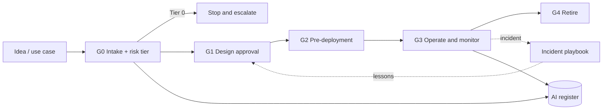

# AI Governance Toolkit

A practical, adoptable toolkit for governing AI systems and **agentic AI** in an enterprise. It turns framework requirements (NIST AI RMF, ISO/IEC 42001, EU AI Act, ISO/IEC 27001, GDPR, India's DPDPA) into things a team can actually use: intake forms, a risk-tiering method, registers, stage-gate checklists, an incident playbook, and a worked impact assessment.

> Built from a PMO and GRC practitioner's point of view: governance only works when it is lightweight enough to be used, and evidence-based enough to be audited.

> **Version 1.1.0 · Last reviewed:** October 2026 (see [`CHANGELOG.md`](CHANGELOG.md)). Regulatory timelines (the EU AI Act as amended by the Digital Omnibus, and the DPDP Rules phasing) keep moving; see [`docs/applicability-guide.md`](docs/applicability-guide.md).

> **Disclaimer:** This toolkit is a starting point for practitioners. It is **not legal advice**, and framework mappings are indicative (clause/article level). Verify against the official texts and your regulators' current guidance before relying on them. All example data is fictional.

## What's inside

| Folder | What you get |
|---|---|
| [`01-intake-and-risk-tiering`](01-intake-and-risk-tiering/) | Use-case intake form, risk-tiering questionnaire, decision flow, autonomy levels for agents |
| [`02-inventory`](02-inventory/) | AI system register and agent register (CSV) with field definitions |
| [`03-control-mapping`](03-control-mapping/) | 26-theme control matrix: NIST AI RMF ↔ ISO/IEC 42001 ↔ EU AI Act ↔ ISO/IEC 27001 ↔ GDPR ↔ DPDPA, plus RBI FREE-AI pillars (advisory), with evidence |
| [`04-lifecycle-gates`](04-lifecycle-gates/) | Five stage-gate checklists (intake → retirement), an agentic AI addendum, a significant-change checklist and a gate tracker |
| [`05-incident-response`](05-incident-response/) | AI incident playbook, severity matrix, incident log, post-incident review |
| [`06-impact-assessment`](06-impact-assessment/) | Impact assessment template (with cross-border transfer section) and two completed fictional examples: a high-risk bank use case and a short-form multi-agent GenAI system |
| [`07-policy-and-templates`](07-policy-and-templates/) | AI policy, GenAI acceptable-use standard, vendor assessment (incl. GPAI checks and ongoing monitoring), model card, test plan, monitoring plan, risk register, exceptions and risk-acceptance process, KPIs |
| [`tools`](tools/) | Python helpers (risk-tier calculator, register validator) with unit tests |
| [`docs`](docs/) | Applicability guide (which regimes apply), roles and RACI, 30-day adoption plan, shadow-AI discovery guide, showcase walkthrough (demo script) |

## How it works



1. **Classify** every AI use case at intake into a tier (0 = prohibited, 1 = high, 2 = medium, 3 = low).
2. **Register** it, including its autonomy level if it is an agent.
3. **Apply controls proportionally**: the tier decides which gates, approvers and evidence are required.
4. **Monitor and respond**: track drift and incidents; learn and feed back.

## Quick start

```bash
# Score a use case (answers in JSON)
python tools/risk_tier.py tools/example_answers.json

# Check the registers are complete and consistent
python tools/validate_register.py 02-inventory/ai-system-register.csv 02-inventory/agent-register.csv

# Run the unit tests
cd tools && python -m unittest test_risk_tier -v
```

To demo the toolkit, follow [`docs/showcase-walkthrough.md`](docs/showcase-walkthrough.md). To adopt it, start with [`docs/applicability-guide.md`](docs/applicability-guide.md) to decide which regimes bind you, then follow the 30-day plan in [`docs/adoption-guide.md`](docs/adoption-guide.md).

## Design principles

- **Proportionate:** low-risk uses get a light path; high-risk uses get the full path.
- **Evidence-first:** every control names the evidence an auditor would ask for.
- **Framework-agnostic core:** one control set, mapped to many frameworks, so you do not run parallel compliance programs.
- **Agent-aware:** autonomy levels, tool permissions, kill switches and approval gates are first-class.

## Author

Rajkumar Mouttou — Portfolio governance, GRC (CRISC, CISA) and agentic AI.
[LinkedIn](https://linkedin.com/in/rajkumar-mouttou)

Contributions and corrections are welcome via issues and pull requests.
